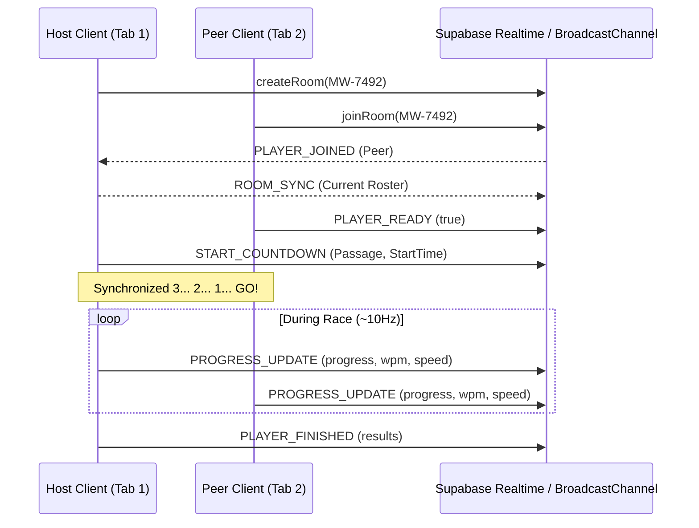

# Meanwhile — System Architecture Blueprint

> **meanwhile** — *a little escape, in your meantime.*  
> Production-ready, minimalist 3D multiplayer typing racing game.

---

## 1. Product Scope & Vision

**meanwhile** transforms mechanical typing practice into a high-octane, cinematic automotive journey. Designed with a luxury automotive aesthetic—midnight navy, charcoal, warm ivory, muted lavender, and subtle sunset-amber accents—the application creates a mindful sanctuary where players accelerate real supercars through precision keystrokes.

### Key Capabilities
- **Typing-Driven Physics:** Character-level keystroke validation directly governs vehicle throttle, speed, RPM, and gear shifting.
- **Cinematic 3D Highways:** 4 curated global circuits (*Coastal Drive*, *Neon City*, *Mountain Pass*, *Desert Run*) with responsive time-of-day atmospheric lighting.
- **Synchronized Multiplayer:** Room creation, 6-digit invite codes (`MW-XXXX`), Supabase Realtime broadcast channels, presence tracking, and native cross-tab communication.
- **Custom Automotive Garage:** 3D studio showroom with turntable camera orbit, performance telemetry bars (Speed, Acceleration, Handling), and bespoke paint lacquer swatches.
- **Global Leaderboards & Career Profiles:** Real-time standings across All Time, This Week, and This Month, with persistent race history and credit balances.
- **Future-Proof Monetization:** Modular, zero-layout-shift `AdSlot` components placed strictly outside active gameplay.

---

## 2. Technology Choices & Justification

| Layer | Technology | Rationale |
|---|---|---|
| **Frontend Framework** | React 19 + Vite | Rapid HMR, zero-overhead bundling, native ESM. |
| **Language** | JavaScript (ESM/JSX) | Pure JSX without cumbersome compile-time type overhead. |
| **Styling** | Tailwind CSS v4 | Curated color tokens, glassmorphism, responsive grid layouts. |
| **3D Rendering** | Three.js + React Three Fiber + Drei | Declarative WebGL rendering, optimized draw calls, dynamic chase cameras. |
| **State Management** | Zustand | Lightweight atomic store, zero boilerplate, decoupled from React renders. |
| **Backend & Realtime** | Supabase (PostgreSQL, Auth, Realtime) | Row Level Security, instant presence channels, serverless scalability. |
| **Audio Engine** | Web Audio API (Synthesized) | Zero external MP3 network dependencies; dynamic RPM pitch modulation. |
| **Deployment** | Vercel | Global Edge network, automated CI/CD from Git. |

---

## 3. Project Directory Structure

```
meanwhile/
├── client/
│   ├── index.html                   # Entry HTML with custom fonts & metadata
│   ├── package.json                 # Client dependencies and Vite scripts
│   ├── vite.config.js               # Vite build configuration
│   └── src/
│       ├── main.jsx                 # React root mount
│       ├── App.jsx                  # Main view router & modal coordinator
│       ├── index.css                # Automotive design system & glassmorphism
│       ├── components/
│       │   ├── auth/                # Supabase Auth modal & Guest conversion
│       │   ├── common/              # Navbar, Footer, and responsive AdSlot
│       │   ├── garage/              # 3D showroom, spec telemetry, paint picker
│       │   ├── home/                # Cinematic hero section & feature showcase
│       │   ├── leaderboard/         # Global rankings table with period filters
│       │   ├── lobby/               # Multiplayer private room creation & join
│       │   ├── profile/             # Driver stats, recent races, and bio editor
│       │   ├── race/                # 3D canvas, Race HUD, Speedometer, Minimap
│       │   └── tracks/              # Track cards, circuit minimaps, mode selector
│       ├── data/
│       │   ├── passages.js          # Curated literary & automotive passages
│       │   ├── tracks.js            # Circuit parameters, skies, and distances
│       │   └── vehicles.js          # Machine specs, top speeds, paint palettes
│       ├── services/
│       │   ├── multiplayer.js       # Realtime presence, broadcast & cross-tab bus
│       │   └── supabase.js          # Supabase client with offline persistent fallback
│       ├── sound/
│       │   └── soundEngine.js       # Synthesized procedural Web Audio API engine
│       └── store/
│           └── useGameStore.js      # Global Zustand game state & race loop
├── supabase/
│   └── migrations/
│       └── 20261025_init.sql        # Tables, triggers, views, and RLS policies
├── vercel.json                      # Vercel single-step deployment config
├── .env.example                     # Environment variables template
├── BLUEPRINT.md                     # Comprehensive architecture blueprint
├── DEPLOYMENT.md                    # Actionable deployment guide
└── README.md                        # Project overview & quickstart
```

---

## 4. Game Mechanics & Typing Physics

### 4.1. Real-time WPM Calculation
Speed calculation conforms to the international standard typing formula:

$$\text{Standard WPM} = \frac{\text{Correct Characters Typed} / 5}{\text{Elapsed Time in Minutes}}$$

To prevent erratic spikes during the first few seconds of a race, a minimum baseline elapsed time ($t_{\min} = 0.01\text{ min}$) is enforced.

### 4.2. Automotive Velocity & Gear Shift Curves
Vehicle velocity ($v_{\text{km/h}}$) is a dynamic function of typing speed and accuracy:

$$v = \min\left(310,\ \max\left(25,\ \text{WPM} \times 1.85 \times \frac{\text{Accuracy}}{100}\right)\right)$$

- **Idle Coasting:** When no typing occurs, velocity smoothly decays toward $25\text{ km/h}$.
- **Accuracy Penalty:** Mistyped characters apply an immediate $12\%$ throttle stutter penalty and trigger a subtle low-frequency acoustic blip.
- **Automated Transmission:** Transmission gears (1 through 6) adapt based on speed brackets:
  - 1st: $0 - 45\text{ km/h}$
  - 2nd: $45 - 85\text{ km/h}$
  - 3rd: $85 - 130\text{ km/h}$
  - 4th: $130 - 180\text{ km/h}$
  - 5th: $180 - 240\text{ km/h}$
  - 6th: $240+\text{ km/h}$

### 4.3. Dynamic Camera & Audio Synthesis
- **Dynamic Field of View (FOV):** The chase camera dynamically interpolates its FOV between $56^\circ$ at standstill and $78^\circ$ at top speed, exaggerating the peripheral motion blur.
- **Engine RPM Audio Synthesis:** A persistent Web Audio `OscillatorNode` (`sawtooth`) passes through a variable `BiquadFilterNode` (`lowpass`), where cutoff frequency ramps from $200\text{ Hz}$ to $800\text{ Hz}$ in tandem with velocity.

---

## 5. Backend, Database Schema & Security

The database layer runs on managed Supabase PostgreSQL with complete Row Level Security (RLS).

### Schema Architecture (`supabase/migrations/20261025_init.sql`)

1. **`public.profiles`**: Stores driver identity, cumulative XP, unlocked vehicles, credit balance, and career records.
2. **`public.race_results`**: Immutable append-only audit trail for verified race completions with constraints ($0 \le \text{wpm} \le 350$).
3. **`public.rooms`**: Multiplayer session states and host metadata.
4. **`public.leaderboard_all_time`**: Materialized view calculating win rates and global ranks.

### Row Level Security (RLS) Policies
- `profiles`: Publicly queryable for leaderboard display; modifications restricted to the profile owner (`auth.uid() = id`).
- `race_results`: Publicly readable; insertable by the authenticated driver.
- `rooms`: Publicly readable; hosts maintain update permissions over their active room.

---

## 6. Multiplayer Synchronization Architecture

Multiplayer supports both global internet connectivity (Supabase Realtime) and zero-latency local development across browser tabs (`BroadcastChannel`):



---

## 7. Monetization & Advertisement Architecture

To allow seamless monetization without redesigning the UI:
- **`AdSlot` Component:** Built with fixed standard responsive dimensions (IAB $728\times90$, $300\times250$).
- **Zero Layout Shift:** When `VITE_ENABLE_ADS=false` (default in production), the component renders `null` with no DOM elements, margins, or padding.
- **Strict In-Game Isolation:** Ad slots are strictly forbidden inside `RaceView` and the 3D WebGL viewport.

---

## 8. Quality Assurance & Performance Strategy

- **Build Performance:** Bundles cleanly under 4 seconds with Vite rolldown chunking.
- **Asset Optimization:** Procedural geometries and soft radial shadow maps eliminate heavy 50MB GLTF downloads.
- **Offline / Guest Tolerance:** Seamless fallback ensures 100% of the game functions locally without Supabase credentials.
